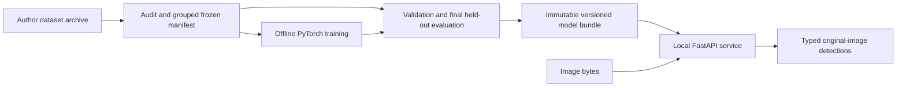

# Standalone component and future integration boundary

Training, evaluation, and benchmarking are explicit local commands. Ordinary
inference requests never train a model. Dataset splits and candidate selection
are recorded before final holdout evaluation. Model identity and geometry travel
with every successful inference response.

The inference service loads a selected bundle once, validates its metadata and
digests, and keeps readiness false on initialization failure. The deterministic
fixture backend is separately identified as simulated. Bundle loading never
downloads weights or silently changes checkpoint, taxonomy, or preprocessing.

The component has no MongoDB, Redis, BullMQ, inspection records, human-review
history, or frontend. It is independently demonstrable through commands, reports,
annotated sample images, and HTTP. The existing
[Visual Inspection Platform](https://github.com/ThePhysic/visual-inspection-platform)
is an architectural reference only and has not been changed.

## Later integration

An adapter in the existing worker can eventually send validated image bytes to
this API with bounded timeouts and map the response to the platform's actual
provider types. The application remains responsible for image storage, durable
jobs, retries, immutable original predictions, and independent review revisions.
Pin and inspect both repository revisions before implementing that adapter;
the illustrative idea-package JSON is not proof of existing TypeScript types.

Joint deployment, frontend changes, worker/provider replacement, end-to-end
application tests, and automated use of human corrections for retraining are
separate milestones. This project makes no Matroid affiliation or production
manufacturing deployment claim.
